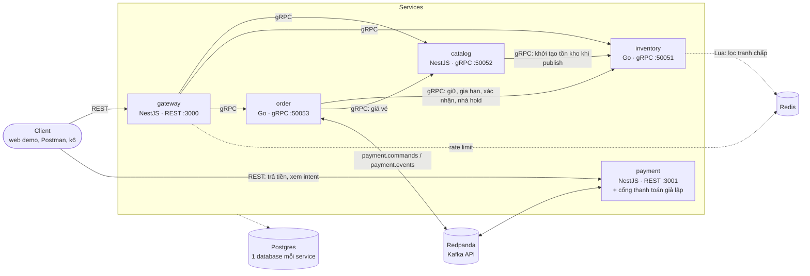
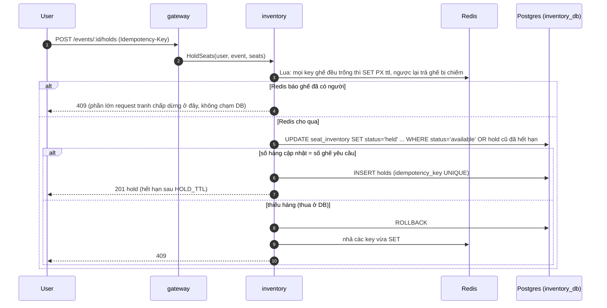
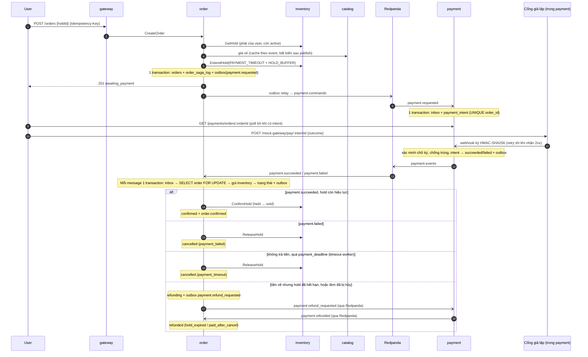
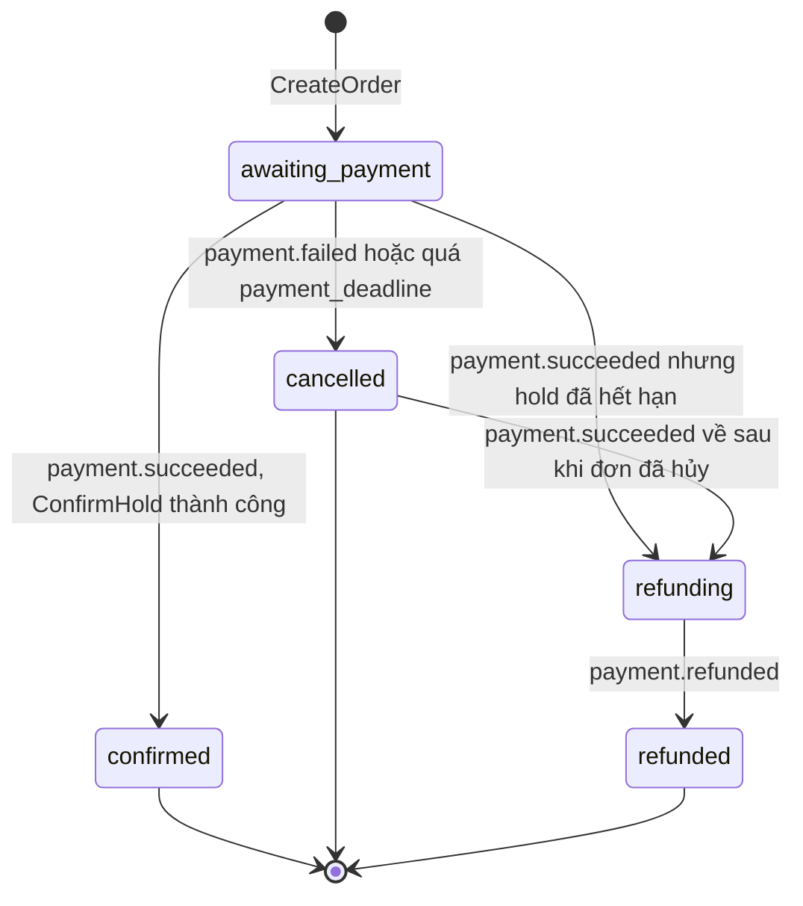

# Ticketing: hệ thống bán vé flash sale (NestJS + Go)

Hệ thống microservice bán vé sự kiện, xây quanh ba bài toán khó của flash sale:

- **Nhiều người tranh cùng một ghế** mà không bao giờ bán vượt.
- **Giữ chỗ có thời hạn**: ghế tự nhả khi người giữ không trả tiền.
- **Thanh toán hỏng giữa chừng** (thẻ bị từ chối, bỏ ngang, tiền về muộn, service sập) mà tiền và ghế vẫn khớp nhau, nhờ Saga + Transactional Outbox/Inbox.

> **5.000 user cùng tranh 100 ghế: 2.614 RPS, 0 lỗi, 100/100 ghế có đúng một chủ, 0 vé bán vượt.**
> Sau mỗi lần load test, script kiểm tra **17 bất biến** trên cả ba database (ghế ↔ hold ↔ đơn ↔ tiền) và tất cả đều PASS, kể cả khi hệ thống bị ép quá tải. Chi tiết ở phần [Load test](#load-test-và-bất-biến).

## Mục lục

- [Kiến trúc](#kiến-trúc)
- [Giữ ghế không bán vượt](#giữ-ghế-không-bán-vượt)
- [Saga thanh toán](#saga-thanh-toán)
- [Độ tin cậy khi gửi nhận message](#độ-tin-cậy-khi-gửi-nhận-message)
- [Load test và bất biến](#load-test-và-bất-biến)
- [Chạy thử](#chạy-thử)
- [Cấu trúc repo](#cấu-trúc-repo)
- [Lộ trình](#lộ-trình)

## Kiến trúc



| Service | Ngôn ngữ | Vai trò |
|---|---|---|
| **gateway** | NestJS | REST công khai, đăng ký/đăng nhập (JWT tự viết, refresh token xoay vòng, thu hồi cả "family" khi token bị dùng lại), RBAC, rate limit theo user/IP bằng Redis, map lỗi gRPC sang HTTP, truyền `x-request-id` xuống các service phía sau |
| **catalog** | NestJS | Venue, event, hạng vé, sơ đồ ghế. Publish event sẽ khởi tạo tồn kho bên inventory, sau đó sơ đồ ghế bị khóa |
| **inventory** | Go | Trái tim chống bán vượt: giữ, gia hạn, xác nhận, nhả ghế; reaper dọn hold hết hạn |
| **order** | Go | Tạo đơn, điều phối Saga thanh toán, outbox relay, consumer `payment.events`, timeout worker |
| **payment** | NestJS | Payment intent, cổng thanh toán giả lập gọi webhook có ký HMAC, hoàn tiền |

- **Đồng bộ (gRPC)** cho những việc cần trả lời ngay: giữ ghế, tạo đơn.
- **Bất đồng bộ (Redpanda)** giữa order và payment, vì thanh toán vốn bất đồng bộ và một bên sập thì bên kia không được kẹt theo.
- **Mỗi service một database**, không JOIN chéo. Proto dùng chung trong `proto/`, sinh code Go và TS bằng `buf`.

## Giữ ghế không bán vượt



- **Redis chỉ là bộ lọc nhanh, Postgres mới là nơi quyết định.** Câu `UPDATE` có điều kiện là atomic: hai transaction không thể cùng chuyển một ghế từ `available` sang `held`. Dù Redis mất dữ liệu hay lệch, kết quả cuối vẫn đúng.
- **Idempotency:** `hold_id` là UUIDv5 sinh từ `(user, Idempotency-Key)`. Bấm lại cùng key thì nhận lại hold cũ, không giữ thêm.
- **Mỗi user chỉ có một hold còn hiệu lực cho mỗi event**, và số ghế mỗi hold có giới hạn.
- **Reaper** định kỳ trả các ghế hết hạn về `available` bằng `FOR UPDATE SKIP LOCKED`, nên chạy nhiều replica vẫn an toàn.
- Test tích hợp: 1.000 goroutine tranh 10 ghế trên Postgres và Redis thật (testcontainers).

## Saga thanh toán

Order là **orchestrator**. Nó gọi inventory đồng bộ, còn nói chuyện với payment qua Redpanda. Mọi message gửi đi đều được ghi vào bảng `outbox` **trong cùng transaction** với thay đổi của đơn, rồi relay publish sau.



Máy trạng thái của đơn:



- **Không có trạng thái `paid` lưu trong DB.** Việc nhận `payment.succeeded` và gọi `ConfirmHold` nằm trong cùng một transaction (đang giữ khóa của đơn), nên đơn đi thẳng sang `confirmed` hoặc `refunding`.
- **Hold sống lâu hơn hạn thanh toán:** khi tạo đơn, hold được gia hạn tới `PAYMENT_TIMEOUT + HOLD_BUFFER`. Tiền về đúng hạn thì ghế chắc chắn vẫn còn.
- **Tiền về muộn không bị mất:** đơn đã hủy mà tiền vẫn về thì đơn chuyển sang hoàn tiền thay vì bỏ qua.

## Độ tin cậy khi gửi nhận message

| Cơ chế | Cách làm |
|---|---|
| **Transactional Outbox** | Thay đổi nghiệp vụ và message nằm trong cùng một transaction. Relay poll `outbox` bằng `FOR UPDATE SKIP LOCKED`, publish với key = `order_id` để giữ thứ tự theo đơn. Đảm bảo at-least-once |
| **Inbox** | Consumer ghi `message_id` vào `inbox` trong cùng transaction nghiệp vụ, message trùng thì bỏ qua. Mỗi message chỉ có tác dụng một lần |
| **Retry / DLQ** (giống nhau ở Go và Nest) | Message sai contract thì vào `<topic>.dlq` ngay. Lỗi tạm thời (Postgres hay inventory sập) thì retry mãi với backoff, **không** vào DLQ, vì vào DLQ đồng nghĩa với bỏ dở một khoản tiền thật. Lỗi khác thì retry `CONSUMER_MAX_ATTEMPTS` lần rồi mới vào DLQ, kèm header `dlq_*` |
| **Webhook** | Ký HMAC-SHA256 trên body thô, có kiểm tra thời gian để chống replay, chống trùng theo id sự kiện. Cổng giả lập lưu charge trong DB và gửi lại với backoff tới khi nhận 2xx |
| **Idempotency REST** | Giữ ghế, tạo đơn và trả tiền đều bắt buộc header `Idempotency-Key`. Id được sinh cố định từ (user, key) nên hai request trùng key chạy song song sẽ tranh cùng một khóa chính |
| **Worker nhiều replica** | Reaper, relay, timeout worker và worker webhook đều nhận việc bằng `FOR UPDATE SKIP LOCKED` hoặc lease |

Chaos test chạy tay trên stack thật đều đạt: dừng order lúc tiền về, dừng payment trước khi nhận lệnh, dừng inventory lúc tiền về, đẩy poison message vào `payment.events`. Saga đều chạy tiếp khi service lên lại, hoặc message rơi vào DLQ.

## Load test và bất biến

Ba kịch bản k6 (`loadtest/k6/`), cộng một script kiểm tra bất biến (`loadtest/verify.mjs`). Script này đọc cả `inventory_db`, `order_db` và `payment_db`, đối chiếu chéo trong JS (các DB tách riêng nên không JOIN được), và thử lại tới khi hệ thống ổn định. 17 bất biến được kiểm tra:

- **Không bán vượt:** không ghế nào thuộc hai hold còn hiệu lực hay hai đơn `confirmed`; tổng ghế `sold` ≤ sức chứa.
- **Ghế ↔ hold ↔ đơn:** ghế `held` thuộc hold `active`, ghế `sold` thuộc hold `confirmed`; số ghế của các đơn `confirmed` bằng số ghế `sold`.
- **Tiền ↔ đơn:** mọi đơn đều có payment intent và trạng thái hai bên khớp nhau. Đã thu tiền mà không có ghế thì đơn phải ở `refunded`.
- **Worker nền đã làm xong việc:** không còn hold hay đơn quá hạn, không còn đơn ở trạng thái trung gian, outbox của order và payment đã publish hết, webhook đã gửi hết.

Kết quả đo trên Docker Desktop (Windows, VM 12 vCPU / 8 GB), mỗi container bị giới hạn CPU/RAM, gateway chạy 3 replica sau nginx:

| Kịch bản | Tải | Kết quả |
|---|---|---|
| `contention`: tranh một nhóm ghế hot | 5.000 VU không nghỉ trong 30s, 100 ghế | 2.614 RPS, 0 lỗi ngoài 201/409, 100/100 ghế có đúng một chủ. Trung vị 240ms, p90 395ms. Ở mức này hệ thống quá tải khoảng 2 lần nên p99 chỉ phản ánh độ dài hàng đợi |
| `contention`, open model | 2.000 req/s | trung vị 20ms, p95 260ms |
| `full_flow`: giữ ghế → tạo đơn → trả tiền → poll tới trạng thái cuối | 500 VU trong 2 phút. Trả tiền: 65% thành công, 20% thẻ bị từ chối, 10% bỏ ngang, 5% trả muộn | 0 lỗi, bán hết 100/100 ghế. Ghế từ đơn bị hủy quay lại bán tiếp. Mọi đơn kết thúc đúng nhánh, kể cả hoàn tiền. Sơ đồ ghế trung vị 4,5ms |
| `spike`: 0 → 4.000 user trong 10s, rate limit thật | khoảng 96.000 request trong 50s | 0 lỗi ngoài 201/409/429, 74% bị chặn 429, không user nào vượt giới hạn, giữ đúng 100/100 ghế. Pha hồi phục sau spike: 0 lỗi, p95 7,8ms |

Load test cũng tìm ra nút thắt thật: lần đầu chạy `full_flow`, catalog (một tiến trình Node) bão hòa ở khoảng 100 lượt xem sơ đồ ghế mỗi giây. Kết quả là 95% request tạo đơn bị 504 và chỉ bán được 59/100 ghế, dù bất biến vẫn PASS: quá tải làm mất doanh thu chứ không làm sai dữ liệu. Cách sửa là cache dữ liệu catalog của event đã publish (dữ liệu này bất biến) ở gateway và order, kèm gộp request trùng khi cache còn trống. Sau khi sửa: 0 lỗi, bán hết 100/100 ghế.

## Chạy thử

**Cần có:** Docker, GNU make (trên Windows dùng Git Bash), Node 24 (`.nvmrc`) cho seed, verify và test Nest, Go 1.27 cho test Go.

```bash
npm install          # workspace Nest + script load test
make up              # dựng toàn bộ stack; migration và tạo topic chạy trong compose
```

| Địa chỉ | Là gì |
|---|---|
| http://localhost:4000 | Web demo: tạo event (admin), sơ đồ ghế, giữ ghế, trả tiền, xem timeline Saga, màn "Đua ghế" cho nhiều bot tranh ghế |
| http://localhost:3000 | gateway REST |
| http://localhost:3001 | payment REST và cổng thanh toán giả lập |
| http://localhost:9080 | Redpanda Console (xem topic, DLQ) |

Tài khoản admin của môi trường dev: `admin@ticketing.local` / `admin12345`.

```bash
make test            # toàn bộ test: Go integration (testcontainers) + Nest unit + e2e
make test-short      # chỉ unit test, không cần container
make e2e             # bộ Postman (cần stack đang chạy)
HOLD_TTL=15s PAYMENT_TIMEOUT=20s make up   # cho hold và thanh toán hết hạn nhanh khi thử tay

# Load test
make loadtest-up                                  # stack load test: 3 replica gateway, giới hạn CPU/RAM, rate limit nới
make seed && make loadtest script=contention && make verify
make seed && make loadtest script=full_flow && make verify
RATE_LIMIT_HOLD=10 make loadtest-up               # spike cần rate limit thật
make seed && make loadtest script=spike && make verify
make loadtest-down && make up                     # quay về stack dev
```

Các tham số của từng kịch bản (`VUS`, `RATE`, `MIX`, `PEAK`, ...) được giải thích ở đầu mỗi file trong `loadtest/k6/`.

## Cấu trúc repo

```
proto/                  hợp đồng gRPC dùng chung (buf)
gen/{go,ts}/            code sinh từ proto, không sửa tay (make proto)
services/
  gateway/              NestJS: REST, auth, rate limit
  catalog/              NestJS: event, sơ đồ ghế, giá vé
  payment/              NestJS: payment intent, cổng giả lập, webhook, hoàn tiền
  inventory/            Go: giữ ghế (Redis Lua + Postgres), reaper
  order/                Go: Saga, outbox relay, consumer, timeout worker
web/                    web demo (React + Vite)
deploy/                 docker-compose, profile load test, nginx
loadtest/               seed, kịch bản k6, kiểm tra bất biến
postman/                bộ test end-to-end trên stack thật
PLAN.md                 kế hoạch và ghi chú từng milestone (chỗ nào khác plan và vì sao)
```

Thư viện chính:
- Go: grpc-go, pgx/v5 + sqlc, go-redis, franz-go, golang-migrate, testcontainers-go.
- NestJS 12 / Node 24: Prisma 7, `@grpc/grpc-js` + ts-proto, kafkajs, `@nestjs/throttler` với storage Redis tự viết.

## Lộ trình

- [x] Phase 1: giữ ghế (gateway, catalog, inventory)
- [x] Phase 2: Saga thanh toán, Outbox/Inbox, DLQ, chaos test
- [x] Phase 3: load test k6 và kiểm tra bất biến
- [ ] Phase 4: Kubernetes (kind). Chạy nhiều replica, cân bằng tải gRPC, HPA/PDB, rolling update và kill pod ngay dưới tải mà bất biến vẫn PASS
